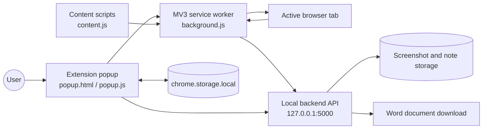
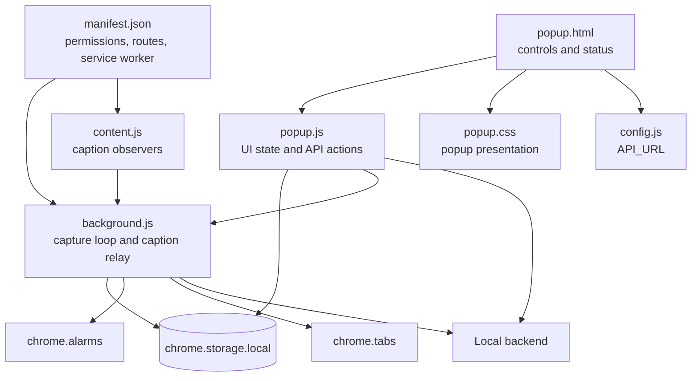
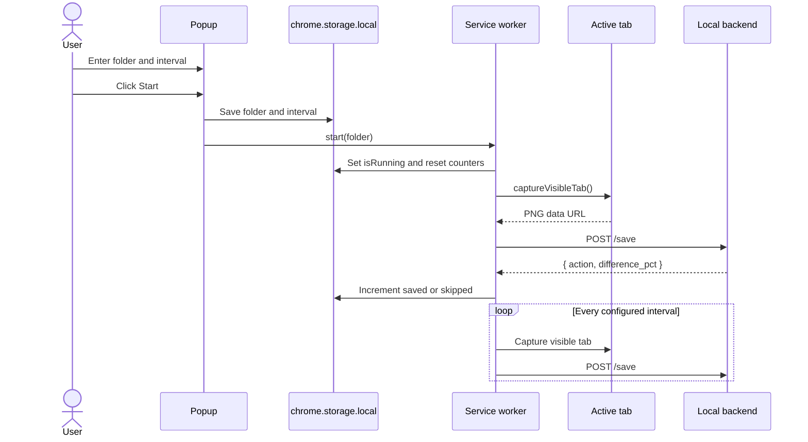
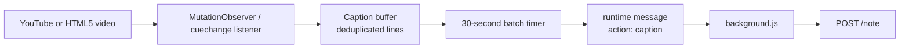

# Oracle Screenshot Tracker

> A Chrome extension that captures the active tab at a configurable interval, stores screenshots through a local backend, collects video captions, saves quick notes, and exports a folder to Word.

## Overview

Oracle Screenshot Tracker is a lightweight learning companion for lectures, tutorials, and technical demos. Start a session from the extension popup, choose a folder and capture interval, and the extension will:

- Capture the visible active tab as a PNG.
- Send each capture to a local API at `http://127.0.0.1:5000`.
- Let the backend decide whether a screenshot is new or visually duplicated.
- Track saved and skipped captures in the popup.
- Extract captions from YouTube and HTML5 video subtitle tracks.
- Save manual and automatic captions as notes.
- Open a Word export endpoint for the selected folder.

The repository contains the browser extension only. The local backend must be supplied separately and implement the API described below.

## Features

| Feature | Description |
| --- | --- |
| Interval capture | Captures the active tab immediately, then repeats every 3–300 seconds. |
| Duplicate filtering | Displays backend-reported `saved` and `skipped` results. |
| Session folders | Groups screenshots and notes under a user-selected folder name. |
| Caption extraction | Watches YouTube caption DOM nodes and HTML5 caption/subtitle tracks. |
| Quick notes | Sends manually entered notes to the local backend. |
| Word export | Opens the backend export route in a new browser tab. |
| MV3 recovery | Uses a Chrome alarm to resume capture after service-worker suspension. |

## Architecture

### System context



### Extension components



### Capture sequence



### Caption flow



## Runtime behavior

1. The popup validates that the folder is non-empty and the interval is at least 3 seconds.
2. `background.js` captures the visible active tab immediately and schedules subsequent captures with `setInterval`.
3. Restricted browser pages such as `chrome://`, `edge://`, `about:`, and extension pages are skipped.
4. The backend decides whether to save the image or skip it as a duplicate.
5. A periodic Chrome alarm checks whether capture should be resumed if the service worker is suspended.
6. Content scripts batch new captions every 30 seconds and send them to the service worker.
7. Caption batches are only persisted while a capture session is running.

## Project structure

```text
.
├── background.js       # Capture loop, alarms, backend requests, caption relay
├── config.js           # Local backend URL
├── content.js          # YouTube and HTML5 caption extraction
├── manifest.json       # Chrome Manifest V3 configuration
├── popup.html          # Extension popup markup
├── popup.js            # Popup controls, notes, export, storage state
├── popup.css           # Popup styling
└── icons/              # Extension icons
```

## Installation

### 1. Start the local backend

Run a backend on `127.0.0.1:5000` with the endpoints in [Backend API contract](#backend-api-contract). The extension does not include that server.

### 2. Load the extension in Chrome

1. Open `chrome://extensions`.
2. Enable **Developer mode**.
3. Select **Load unpacked**.
4. Choose this repository directory.
5. Pin **Oracle Screenshot Tracker** from the extensions menu.

After changing extension files, return to `chrome://extensions` and click **Reload** for the extension.

## Usage

### Capture screenshots

1. Open a capturable web page.
2. Open the extension popup.
3. Enter a folder name, such as `Java Lecture 3`.
4. Set an interval from 3 to 300 seconds.
5. Click **Start**.
6. Click **Stop** when the session is complete.

The popup shows the number of screenshots reported as saved or skipped by the backend.

### Save notes

Enter text in **Quick Note** and click **Save Note**. Notes are stored in the currently selected folder.

While capture is running, supported video captions are automatically saved with the `[Auto-Caption]` prefix.

### Export notes and screenshots

Enter a folder name and click **Export to Word**. The extension opens:

```text
GET http://127.0.0.1:5000/export/<url-encoded-folder>
```

The backend should respond with a downloadable Word document.

## Backend API contract

The backend is intentionally separate from this repository. Implement these routes:

### `POST /save`

Request:

```json
{
  "image": "data:image/png;base64,...",
  "title": "Current tab title",
  "url": "https://example.com/lesson",
  "folder": "Java Lecture 3"
}
```

Expected response:

```json
{
  "action": "saved",
  "difference_pct": 12.34
}
```

`action` must be either `saved` or `skipped`. `difference_pct` is displayed in the service-worker log and may be used by the backend to explain duplicate decisions.

### `POST /note`

Request:

```json
{
  "folder": "Java Lecture 3",
  "text": "Remember the difference between an interface and an abstract class."
}
```

Expected response:

```json
{
  "status": "success"
}
```

### `GET /export/<folder>`

Return a Word-compatible file download for the requested URL-decoded folder. The extension opens this route in a new tab.

## Permissions and privacy

The extension requests:

- `storage` for session state and counters.
- `tabs` and `activeTab` to identify and capture the active tab.
- `alarms` to recover the capture loop after service-worker suspension.
- `<all_urls>` and `http://127.0.0.1:5000/*` for page access and local API communication.

Screenshots, tab titles, URLs, notes, and captions are sent to the configured backend. By default, that backend is local-only at `127.0.0.1`. Review or change `API_URL` in `config.js` before using a remote server.

The extension does not capture restricted browser pages. Caption extraction is currently injected only on:

- `*.youtube.com`
- `*.oracle.com`

## Configuration

Change the backend address in `config.js`:

```js
const API_URL = "http://127.0.0.1:5000";
```

If the backend is moved to another host, update both `API_URL` and the `host_permissions` entry in `manifest.json`, then reload the extension.

## Troubleshooting

| Symptom | Check |
| --- | --- |
| Start does nothing | Enter a folder name and use an interval of at least 3 seconds. |
| Screenshots are skipped | Confirm the active page is not a restricted browser page and inspect the backend response. |
| `Server offline` appears | Confirm the backend is listening on `127.0.0.1:5000` and accepts `POST /note`. |
| Export does not download | Verify `GET /export/<folder>` returns a file response. |
| Captions are missing | Confirm captions are enabled and the page is YouTube or Oracle; captions are sent in 30-second batches. |
| Changes are not visible | Reload the extension from `chrome://extensions`. |

## Development notes

This project is plain JavaScript and does not require a build step or package manager. Keep the extension reloadable as an unpacked Manifest V3 extension and test changes in Chrome with the service-worker console open from `chrome://extensions`.

## License

No license file is currently included. Add a license before distributing the project.
